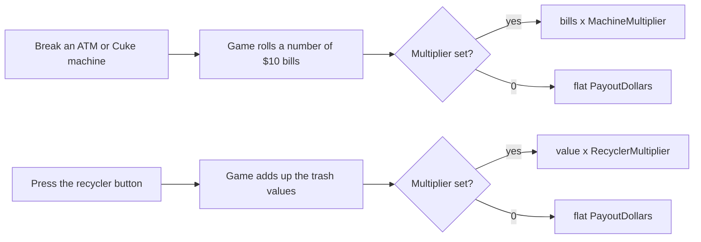

# Fixed Cash Drops

A payout mod for [Schedule I](https://store.steampowered.com/app/3164500/Schedule_I/). Broken ATMs, broken Cuke machines and trash recyclers pay more: the game's own amount, multiplied.

Built for the default (IL2CPP) branch of the game with MelonLoader.

## What it does

The game already decides how much each of these pays. This mod keeps that roll and scales it.

| Source | Vanilla | With the default 7x |
|---|---|---|
| Broken ATM | random, $20 to $80 | $140 to $560 |
| Broken Cuke machine | random, $10 to $40 | $70 to $280 |
| Trash recycler | sum of the trash put in | that sum times 7 |

Recyclers still reward what you collect. Every piece of trash has its own value in the game:

| Value | Examples |
|---|---|
| $1 | cigarette, cigarette box, soil bag, syringe, plant scrap, seed vial, fertilizer |
| $2 | coffee cup, cuke can, water bottle, energy drink, chemical jug, pipe, acid |
| $3 | glass bottle, gasoline, motor oil, bong, gun magazine, revolver cylinder |

Trash bags count by what is inside them.



## Install

1. Install [MelonLoader](https://melonwiki.xyz/) 0.7.x into Schedule I and start the game once.
2. Build the mod (see below) or take a built `ATMFixedDrop.dll`.
3. Copy it into `Schedule I\Mods\`.
4. Start the game. The console prints a line such as `Fixed Cash Drops v1.9 loaded. ATMs: random roll x7, Cuke machines: random roll x7, recyclers: trash value x7.`

In multiplayer the host's copy of the mod decides the payouts.

## Settings

`Schedule I\UserData\MelonPreferences.cfg`, section `[ATMFixedDrop]`.

| Setting | Default | Meaning |
|---|---|---|
| `MachineMultiplier` | `7` | Broken ATMs and Cuke machines drop the game's roll times this. `0` = always drop a flat `PayoutDollars`. |
| `RecyclerMultiplier` | `7` | Recyclers pay the real trash value times this. `0` = a flat `PayoutDollars` per press, whatever is inside. |
| `PayoutDollars` | `200` | The flat amount, only used where a multiplier is `0`. Rounded down to the nearest $10 for ATMs and Cuke machines. |
| `FixATM` | `true` | `false` leaves ATMs vanilla. |
| `FixCukeMachine` | `true` | `false` leaves Cuke machines vanilla. |
| `FixRecycler` | `true` | `false` leaves recyclers vanilla. |
| `VerboseLog` | `false` | Log every recycler value change, for troubleshooting. |

All three payouts live in this one DLL. To turn just one of them off, use its `Fix...` switch instead of removing the file.

## How it works

The obvious static fields (`ATM.MinCashDrop`, `ATM.MaxCashDrop`) have no effect at runtime. The amount that actually gets paid is a local variable inside each machine's coroutine, so the mod patches the coroutine's `MoveNext` and rewrites that value once per break or per recycler run.

- **ATM and Cuke machine:** the local `cashDrop` is a count of $10 bills.
- **Recycler:** the local `value` is the summed `SellValue` of the trash. `Recycler.SetCashValue` carries the same number to the machine's cash and its screen, so both are changed with the same rule and always agree.

## Build

Requirements: .NET SDK 6 or newer, Schedule I with MelonLoader installed and started once.

```
dotnet build -c Release
```

The project references the game's assemblies from `C:\Program Files (x86)\Steam\steamapps\common\Schedule I`; change `GamePath` in `ATMFixedDrop.csproj` if your game is installed elsewhere.

Tested on game version 0.4.7f12.

## Related mods

- [schedule1-supply-run](https://github.com/purplehaxttv/schedule1-supply-run): a courier that moves your own stock between properties.
- [schedule1-chat-fx](https://github.com/purplehaxttv/schedule1-chat-fx): lets Firebot chat commands and redeems trigger effects in the game.
